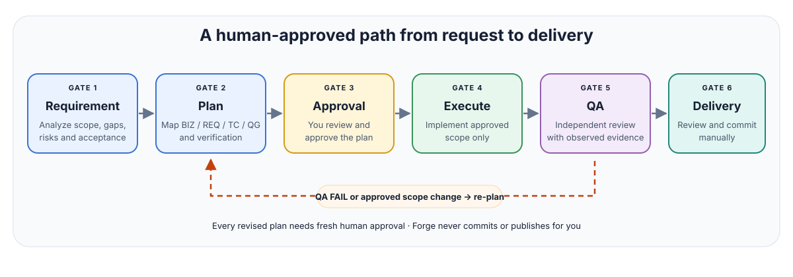
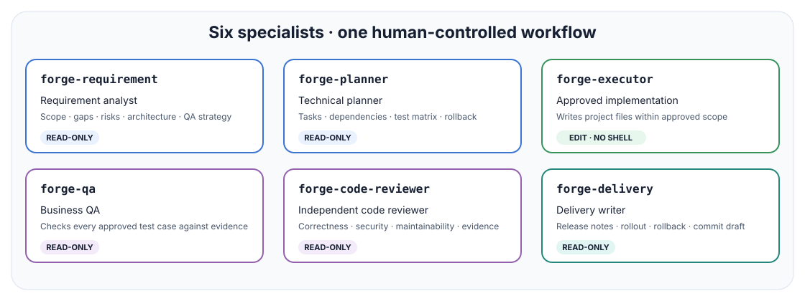
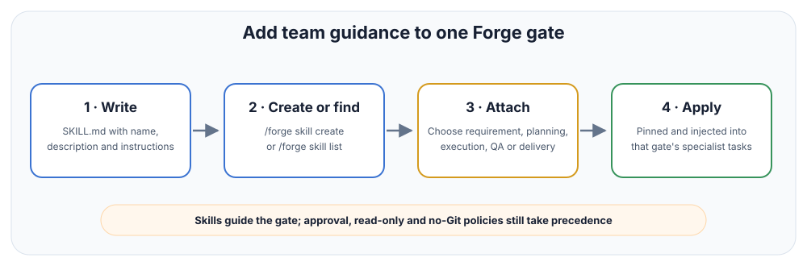

# Forge

**A human-approved, evidence-driven workflow for AI coding agents.** Forge turns a coding request into an auditable plan, explicit human approval, implementation, independent code review with evidence-based QA, and a copy-ready delivery report.

[English](README.md) · [ภาษาไทย](README_TH.md) · [User guide](docs/USER_GUIDE.md) · [Custom skills](docs/CUSTOM_SKILLS.md) · [Installation](docs/INSTALL.md) · [Security notes](docs/SECURITY.md)



Forge currently supports **Oh My Pi (OMP)** as an extension and **Claude Code** as a plugin. Both adapters use the shared Forge core; some host features differ.

## Why Forge

- **Approval before implementation.** The coding agent cannot approve its own plan. A human reviews and approves the plan before execution.
- **Traceable requirements and tests.** Plans map business topics, requirements, test cases, and quality gates (`BIZ`, `REQ`, `TC`, `QG`).
- **Independent QA.** QA checks the approved plan against observed evidence. A test that did not run is not reported as passing.
- **Rework requires your decision and fresh approval.** After QA FAIL/BLOCKED, Forge waits for you to choose a fix; the rework plan then needs a new approval. Execution cannot reuse a superseded approval.
- **Manual Git publishing.** Forge does not stage, commit, push, merge, or publish changes for you.



## Workflow

| Stage | What happens |
|---|---|
| Plan | The main agent explores the code itself (with parallel read-only research subagents), asks only real preference questions, and writes a plan with traceable BIZ/REQ/TC/QG coverage. The working tree stays read-only. |
| Approval | You inspect and approve the plan in Forge's approval dialog (OMP) or Claude Code's native plan prompt. No approval is inferred. |
| Execute | The main agent implements the approved plan step by step and may delegate slices to subagents. |
| QA | The main agent runs the plan's checks and verifies every test case while `forge-code-reviewer` independently reviews the diff. Every CRITICAL/HIGH reviewer finding must appear in the QA submission, either kept at CRITICAL/HIGH (gate FAILs) or marked `Disputed:` with counter-evidence. QA is read-only. |
| Delivery | After QA passes, the main agent prepares rollout notes and a commit message for you to review and copy. |

After every QA submission, Forge shows a QA summary: a header (`Forge QA ✅ PASS / ❌ FAIL / ⚠️ BLOCKED`) with counts and the report path, one row per test case (✅ ❌ ⚠️ ⏸️), a quality-gate table, code-review findings (🔴 CRITICAL 🟠 HIGH 🟡 MEDIUM ⚪ LOW) and gate blockers. OMP shows it in the TUI; in Claude Code the agent prints it verbatim.

QA FAIL or BLOCKED does not start a fix on its own; the footer shows `QA failed · your decision` / `QA blocked · your decision`. In OMP a dialog opens: plan the fix, plan the fix with your notes, rerun QA (BLOCKED only), or not now (keeps the report; `/forge review` reopens it). In Claude Code, run `/forge-rework`, `/forge-qa` (BLOCKED) or `/forge-off`. A rework plan still needs normal plan approval before any code changes.

The plan must contain `## Context`, `## Approach`, `## Verification`, `## Assumptions & contingencies` and the BIZ/REQ/TC/QG sections. `## Approach` must include an `Open decisions:` line (`none`, or one sub-bullet per decision with `default: …`; a `BLOCKER` item is rejected until the user is asked) and a `Migration & rollback:` line (steps, or `not applicable — <reason>`). Forge rejects a proposal that misses any of these.

## Custom skills (OMP)

OMP lets you create a Markdown skill and attach it to a Forge gate. Example skill:

```markdown
---
name: api-contract-review
description: Check API contract changes during planning.
---

# API contract review
- Identify breaking request and response changes.
- Keep stable IDs and require an acceptance test for each change.
```

Create it and attach it to planning with `/forge skill create planning`, or place it at `~/.omp/agent/skills/api-contract-review/SKILL.md` and run:

```text
/forge skill add planning api-contract-review
/forge skills
```

Skills are pinned for each new workflow and included in the main agent's gate instructions and required specialist tasks. They cannot override approval, read-only, or no-Git rules. Create, add, remove, or reset bindings only when no Forge workflow is active. See the [custom skills guide](docs/CUSTOM_SKILLS.md) for validation limits and commands.




## Quick start

### Requirements

- Node.js **22 or newer** to build and test Forge.
- OMP or Claude Code installed and configured with the agents/models you intend to use.
- A local clone of this repository. Replace `<repository-url>` with the HTTPS URL shown by your Git host.

```bash
git clone <repository-url>
cd <repository-directory>
npm run build
```

### Install for OMP

```bash
cd dist/omp/omp-forge-global-v6.1.0
bash ./install.sh
```

Restart OMP. In the main session, run:

```text
/forge
```

Enter a requirement after the prefixed prompt, or start directly with `/forge <requirement>`. Check progress with `/forge status`.

### Install for Claude Code

From the repository root, build the local plugin package with `npm run build`, then run these commands in Claude Code. Use the absolute path to your clone:

```text
/plugin marketplace add /absolute/path/to/<repository-directory>/dist/claude-code/forge-marketplace
/plugin install forge@forge-local
```

Restart Claude Code, then start with `/forge <requirement>`. See the [Claude Code guide](adapters/claude-code/README.md).

To update an existing local installation, rebuild and replace the marketplace folder you originally registered with the new `dist/claude-code/forge-marketplace` folder. Back up the old folder first; do not overlay it, because removed agents and commands would remain. Then run `claude plugin update forge@forge-local --scope user` and restart Claude Code. Check `/agents` for `forge:forge-code-reviewer` and `forge:forge-plan-critic`.

More detailed update, custom data-directory, and uninstall steps: [Installation guide](docs/INSTALL.md).

## Example

```text
/forge Add CSV export to the booking service. Include authorization checks, tests, and a rollback plan.
```

Review the generated plan. **Approve only after the plan matches your intent.** Forge implements after approval, runs independent QA, and prepares a delivery summary if QA passes.

In OMP, a plain prompt typed while a workflow is active opens a **Steer / Cancel** dialog. Steer applies the prompt to the requirement and re-enters planning; after execution approval, it revokes approval and requires a revised, newly approved plan. Cancel leaves the workflow unchanged and returns the prompt to the editor. This prompt-steering dialog is currently OMP-specific.


## Agent roles

| Agent | Responsibility | Access |
|---|---|---|
| `forge-code-reviewer` | Independent, diff-scoped code and security review during QA (`CR-001 [HIGH] file:line — evidence — fix`) | Read-only |
| `forge-plan-critic` | Optional plan critique before proposal, when plan review is ON (`PC-001 [HIGH] …`) | Read-only |

Planning, execution, QA verification and delivery are done by the main agent. Read-only research subagents (`scout` in OMP, `Explore` in Claude Code) may help during planning.

## Commands

OMP commands use `/forge <subcommand>`; Claude Code also exposes dedicated `/forge-*` shortcuts.

| Action | OMP | Claude Code |
|---|---|---|
| Start | `/forge <requirement>` | `/forge <requirement>` |
| Status | `/forge status` | `/forge-status` or `/forge status` |
| Review a plan / reopen QA decision | `/forge review` | Native plan approval |
| Retry QA | `/forge qa` | `/forge-qa` |
| Plan a fix after QA FAIL/BLOCKED | `/forge rework` | `/forge-rework` |
| Delivery/report | `/forge delivery`, `/forge report` | `/forge-delivery`, `/forge-report` |
| Resume/recover | `/forge resume`, `/forge recover` | `/forge-resume` |
| Cancel workflow | `/forge off` | `/forge-off` |
| Optional plan critic (new workflows) | `/forge planreview on\|off` | `/forge-planreview on\|off` |
| Custom skills | `/forge skill`, `/forge skills`, `/forge skill list` | Not available |

OMP also supports `/forge agents` and custom gate skills; Claude Code does not currently expose this skill manager. Plan review is OFF by default; when ON, the main agent must run `forge-plan-critic` once on the written plan and cite every CRITICAL/HIGH PC-id in the plan before Forge accepts the proposal. `/forge status` shows `plan review: ON/OFF`. For all commands and phase behavior, see the [user guide](docs/USER_GUIDE.md).

## Model profiles and cost

Forge calls multiple agents, so usage depends on the selected model profile, task size, and host. Profiles change model assignments, not workflow gates. Build with one of:

```bash
FORGE_MODELS=rigor npm run build       # default
FORGE_MODELS=balanced npm run build
FORGE_MODELS=economy npm run build
```

OMP preserves installed agent definitions by default. Change models through OMP `/agents`, or explicitly replace bundled agent files with `FORGE_REINSTALL_AGENTS=1 bash ./install.sh` (the installer keeps backups).

## Build and test

```bash
npm test
```

This builds both adapters, runs the core and example tests, runs OMP tests plus its installer smoke test, and runs Claude Code adapter tests. Requires Node.js 22+.

Contributor and architecture documentation: [Development](docs/DEVELOPMENT.md) · [Architecture](docs/ARCHITECTURE.md).

## Data and safety

Forge stores workflow state, local plans, reports, and delivery artifacts in adapter/session data locations rather than in the project by default. See [data locations and privacy](docs/USER_GUIDE.md#data-and-privacy).

Forge guardrails control agent tool calls; **Forge is not a security sandbox**. Nested scripts, external tools, MCP servers, host behavior, or user actions can bypass some controls. Use it only in repositories and environments you trust. Review the diff and run your own checks before merging or publishing.

## License

This repository currently has no `LICENSE` file. Public visibility does not grant permission to reuse or redistribute the code. Add a license before inviting public contributions or granting reuse rights.
