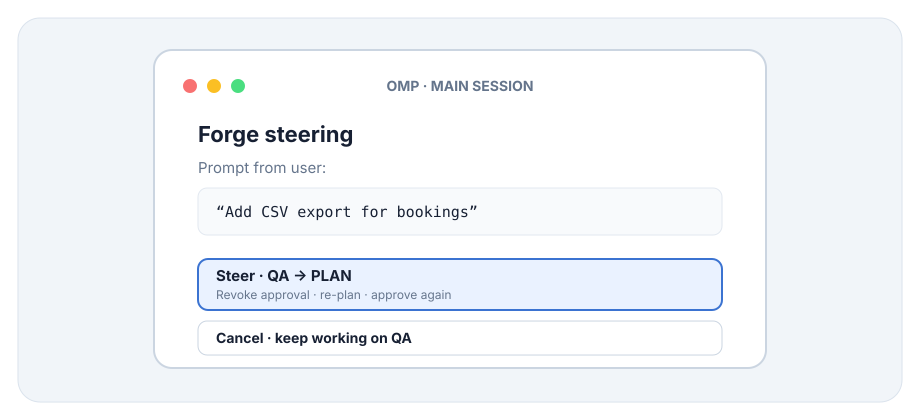

# Forge

**A human-approved, evidence-driven workflow for AI coding agents.** Forge turns a coding request into a requirement analysis, an auditable plan, an explicit human approval, implementation, independent QA, and a copy-ready delivery report.

[English](README.md) · [ภาษาไทย](README_TH.md) · [User guide](docs/USER_GUIDE.md) · [Custom skills](docs/CUSTOM_SKILLS.md) · [Installation](docs/INSTALL.md) · [Security notes](docs/SECURITY.md)


Forge currently supports **Oh My Pi (OMP)** as an extension and **Claude Code** as a plugin. Both adapters use the shared Forge core; some host features differ.

## Why Forge

- **Approval before implementation.** The coding agent cannot approve its own plan. A human reviews and approves the plan before execution.
- **Traceable requirements and tests.** Plans map business topics, requirements, test cases, and quality gates (`BIZ`, `REQ`, `TC`, `QG`).
- **Independent QA.** QA checks the approved plan against observed evidence. A test that did not run is not reported as passing.
- **Rework requires fresh approval.** QA failures and approved scope changes return to planning; execution cannot reuse a superseded approval.
- **Manual Git publishing.** Forge does not stage, commit, push, merge, or publish changes for you.


## Workflow

| Stage | What happens |
|---|---|
| Requirement | `forge-requirement` analyzes goals, scope, gaps, risks, architecture, and QA strategy in one pass. The main agent reviews its report. |
| Plan | `forge-planner` prepares an implementation plan with traceable BIZ/REQ/TC/QG coverage. |
| Approval | You inspect and approve the plan in the host's native approval UI. No approval is inferred. |
| Execute | `forge-executor` implements the approved plan. It has no shell access. |
| QA | `forge-qa` and `forge-code-reviewer` independently review evidence and code. QA is read-only. |
| Delivery | After QA passes, `forge-delivery` prepares rollout notes and a commit message for you to review and copy. |

If QA fails, Forge returns to planning and requires a new approval. If evidence is missing, QA stays blocked until you collect evidence or explicitly request rework.

## Custom skills (OMP)

OMP lets you create a Markdown skill and attach it to a Forge gate. Example skill:

```markdown
---
name: api-contract-review
description: Check API contract changes during planning.
---

# API contract review
- Identify breaking request and response changes.
- Keep stable IDs and require an acceptance test for each change.
```

Create it and attach it to planning with `/forge skill create planning`, or place it at `~/.omp/agent/skills/api-contract-review/SKILL.md` and run:

```text
/forge skill add planning api-contract-review
/forge skills
```

Skills are pinned for each new workflow and included in that gate's specialist tasks. They cannot override approval, read-only, or no-Git rules. Create, add, remove, or reset bindings only when no Forge workflow is active. See the [custom skills guide](docs/CUSTOM_SKILLS.md) for validation limits and commands.


## Quick start

### Requirements

- Node.js **22 or newer** to build and test Forge.
- OMP or Claude Code installed and configured with the agents/models you intend to use.
- A local clone of this repository. Replace `<repository-url>` with the HTTPS URL shown by your Git host.

```bash
git clone <repository-url>
cd <repository-directory>
npm run build
```

### Install for OMP

```bash
cd dist/omp/omp-forge-global-v6.1.0
bash ./install.sh
```

Restart OMP. In the main session, run:

```text
/forge
```

Enter a requirement after the prefixed prompt, or start directly with `/forge <requirement>`. Check progress with `/forge status`.

### Install for Claude Code

From the repository root, build the local plugin package with `npm run build`, then run these commands in Claude Code. Use the absolute path to your clone:

```text
/plugin marketplace add /absolute/path/to/<repository-directory>/dist/claude-code/forge-marketplace
/plugin install forge@forge-local
```

Restart Claude Code, then start with `/forge <requirement>`. See the [Claude Code guide](adapters/claude-code/README.md).

More detailed update, custom data-directory, and uninstall steps: [Installation guide](docs/INSTALL.md).

## Example

```text
/forge Add CSV export to the booking service. Include authorization checks, tests, and a rollback plan.
```

Review the requirement summary, then review the generated plan. **Approve only after the plan matches your intent.** Forge implements after approval, runs independent QA, and prepares a delivery summary if QA passes.

In OMP, a plain prompt typed while a workflow is active opens a **Steer / Cancel** dialog. Steer applies the prompt to the requirement and returns to the relevant gate; after execution approval, it revokes approval and requires a revised, newly approved plan. Cancel leaves the workflow unchanged and returns the prompt to the editor. This prompt-steering dialog is currently OMP-specific.



## Agent roles

| Agent | Responsibility | Access |
|---|---|---|
| `forge-requirement` | Requirement analysis, gaps, risks, architecture, QA strategy, self-challenge | Read-only |
| `forge-planner` | Implementation plan and test traceability | Read-only |
| `forge-executor` | Implement the approved plan | Can edit files; no shell |
| `forge-qa` | Verify planned business tests and evidence | Read-only |
| `forge-code-reviewer` | Independent code and security review | Read-only |
| `forge-delivery` | Delivery, rollout/rollback notes, and commit-message draft | Read-only |

## Commands

OMP commands use `/forge <subcommand>`; Claude Code also exposes dedicated `/forge-*` shortcuts.

| Action | OMP | Claude Code |
|---|---|---|
| Start | `/forge <requirement>` | `/forge <requirement>` |
| Status | `/forge status` | `/forge-status` or `/forge status` |
| Review a plan | `/forge review` | Native plan approval |
| Retry QA | `/forge qa` | `/forge-qa` |
| Rework after QA FAIL/BLOCKED | `/forge rework` | `/forge-rework` |
| Delivery/report | `/forge delivery`, `/forge report` | `/forge-delivery`, `/forge-report` |
| Resume/recover | `/forge resume`, `/forge recover` | `/forge-resume` |
| Cancel workflow | `/forge off` | `/forge-off` |
| Custom skills | `/forge skill`, `/forge skills`, `/forge skill list` | Not available |

OMP also supports `/forge agents` and custom gate skills; Claude Code does not currently expose this skill manager. For all commands and phase behavior, see the [user guide](docs/USER_GUIDE.md).

## Model profiles and cost

Forge calls multiple agents, so usage depends on the selected model profile, task size, and host. Profiles change model assignments, not workflow gates. Build with one of:

```bash
FORGE_MODELS=rigor npm run build       # default
FORGE_MODELS=balanced npm run build
FORGE_MODELS=economy npm run build
```

OMP preserves installed agent definitions by default. Change models through OMP `/agents`, or explicitly replace bundled agent files with `FORGE_REINSTALL_AGENTS=1 bash ./install.sh` (the installer keeps backups).

## Build and test

```bash
npm test
```

This builds both adapters, runs the core and example tests, runs OMP tests plus its installer smoke test, and runs Claude Code adapter tests. Requires Node.js 22+.

Contributor and architecture documentation: [Development](docs/DEVELOPMENT.md) · [Architecture](docs/ARCHITECTURE.md).

## Data and safety

Forge stores workflow state, local plans, reports, and delivery artifacts in adapter/session data locations rather than in the project by default. See [data locations and privacy](docs/USER_GUIDE.md#data-and-privacy).

Forge guardrails control agent tool calls; **Forge is not a security sandbox**. Nested scripts, external tools, MCP servers, host behavior, or user actions can bypass some controls. Use it only in repositories and environments you trust. Review the diff and run your own checks before merging or publishing.

## License

This repository currently has no `LICENSE` file. Public visibility does not grant permission to reuse or redistribute the code. Add a license before inviting public contributions or granting reuse rights.
