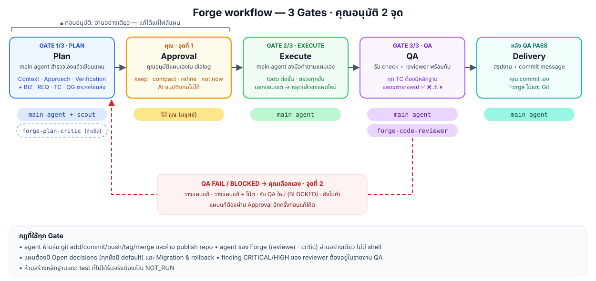
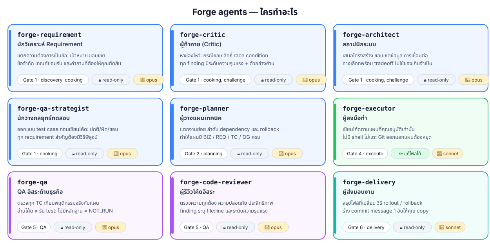

# Forge · เอกสารภาษาไทย
**English:** [README](README.md) · [คู่มือผู้ใช้](docs/USER_GUIDE.md) · [Custom skills (OMP)](docs/CUSTOM_SKILLS.md) · [ติดตั้ง](docs/INSTALL.md) · [ความปลอดภัย](docs/SECURITY.md)

**Forge** ทำให้ AI เขียนโค้ดอย่างมีขั้นตอนแบบทีมจริง: วางแผน → **คุณอนุมัติ** → ลงมือ → QA อิสระ → ส่งมอบ
main agent ทำงานแต่ละขั้นเอง มี `forge-code-reviewer` รีวิว diff อิสระตอน QA และ Forge จะไม่ยอมให้ข้ามขั้น

ใช้ได้กับ **Claude Code** (plugin) และ **Oh My Pi / OMP** (extension) โดยใช้ core เดียวกัน



## ทำไมต้อง Forge

- **ไม่แก้ implementation ก่อนอนุมัติ** — agent แก้ไฟล์งานได้หลังคุณอนุมัติแผนเท่านั้น
- **ตรวจได้ทุกข้อ** — แผนต้องมี Business Topic (BIZ), Requirement (REQ), Test Case (TC) และ Quality Gate (QG) ที่ QA ใช้ตรวจย้อนได้ทีละข้อ
- **QA ไม่เชื่อคำพูด** — test ที่ไม่ได้รันจริงต้องเป็น `NOT_RUN` ถ้า QA ไม่ผ่าน Forge รอให้คุณตัดสินใจก่อนวางแผนแก้ และแผนแก้ต้องอนุมัติใหม่
- **Git เป็นของคุณ** — agent ห้าม `git add/commit/push` และห้าม publish ทุกขั้น Forge แค่ร่าง commit message ให้ copy

## Agent ของ Forge



| Agent | Gate | หน้าที่ | สิทธิ์ |
|---|---|---|---|
| `forge-code-reviewer` | 3 (QA) | รีวิวเฉพาะไฟล์ที่เปลี่ยน: ความถูกต้อง ความปลอดภัย ประสิทธิภาพ รายงานบรรทัดละ finding: `CR-001 [HIGH] file:line — evidence — fix` | อ่านอย่างเดียว |
| `forge-plan-critic` | 1 (เฉพาะเมื่อเปิด plan review) | วิจารณ์แผนที่เขียนแล้วก่อนส่งอนุมัติ รายงาน `PC-001 [HIGH] …` | อ่านอย่างเดียว |

งานที่เหลือ main agent ทำเอง: Gate 1 วางแผน (สำรวจโค้ดเอง ใช้ research subagent แบบอ่านอย่างเดียวได้: `scout` ใน OMP, `Explore` ใน Claude Code), Gate 2 ลงมือตามแผน, Gate 3 รัน check และตรวจทุก TC แล้วทำ delivery เอง

## คำสั่ง

พิมพ์ `/forge` ใน Claude Code แล้วเลือกจากเมนูได้เลย (ใน OMP ใช้ `/forge <คำสั่งย่อย>` เช่น `/forge status`)

| คำสั่ง | ใช้เมื่อ |
|---|---|
| `/forge <requirement>` | เริ่มงานใหม่ |
| `/forge-status` | ดูว่าอยู่ Gate ไหน กำลังรอ agent ตัวไหน และ `plan review: ON/OFF` |
| `/forge-plan` | ดู path ของแผนที่ส่งอนุมัติ |
| `/forge-approve` | อนุมัติแผนเอง เมื่อ Forge มองไม่เห็นการอนุมัติ (เช่น context ถูกล้าง) |
| `/forge-qa` | เริ่มหรือรัน QA ใหม่ (เช่น หลังเก็บหลักฐานที่ขาดเมื่อ QA BLOCKED) |
| `/forge-rework` | สั่งวางแผนแก้หลัง QA ไม่ผ่าน (FAIL/BLOCKED) แผนแก้ต้องอนุมัติใหม่ |
| `/forge-delivery` | ดู commit message หรือทำขั้นส่งมอบต่อ |
| `/forge-report` | ดู path รายงาน QA ล่าสุด |
| `/forge-resume [เลข]` | ดูงาน Forge ใน session อื่นของโปรเจกต์นี้ หรือดึงมาทำต่อ |
| `/forge-agents` | รายชื่อ agent |
| `/forge-planreview on\|off` | เปิด/ปิด plan critic (ค่าเริ่มต้น OFF บันทึกใน config ของ Forge มีผลกับงานใหม่) เมื่อเปิด main ต้องรัน `forge-plan-critic` 1 ครั้งกับแผนที่เขียนแล้ว และอ้าง PC-id ระดับ CRITICAL/HIGH ทุกข้อในแผน ไม่งั้น Forge ไม่รับแผน |
| `/forge-trace [on\|off]` | บันทึก event สำหรับทดสอบ flow (ดู [แผนทดสอบ](docs/E2E-TEST-PLAN_TH.md)) |
| `/forge-off` | ยกเลิกงาน (ไม่แก้ไฟล์ ไม่แตะ Git) |

AI เรียกคำสั่งเหล่านี้แทนคุณไม่ได้ ทุกคำสั่งต้องพิมพ์เอง

## Plan mode แบบ OMP

เดิม Gate 1–2 ใช้ `forge-requirement` แล้วต่อด้วย `forge-planner` (ถูกเอาออกแล้ว) แต่ละตัวสำรวจโค้ดซ้ำเอง ตอนนี้ main agent วางแผนเองแบบ plan mode ของ OMP:

| สิ่งที่รักษาคุณภาพไว้ | ทำอย่างไร |
|---|---|
| อ้างอิงโค้ดจริง | main อ่าน/grep/glob เอง หรือส่ง `scout` (Claude Code: `Explore`) หลายตัวขนานกัน ทุก path/symbol ที่อ้างต้องอ่านมาแล้ว |
| ถามเฉพาะสิ่งที่โค้ดตอบไม่ได้ | ใช้ ask (Claude Code: AskUserQuestion) 2–4 ตัวเลือก พร้อมค่าแนะนำ |
| แผนลงมือได้ทันที | แผนต้องมี `## Context`, `## Approach`, `## Verification`, `## Assumptions & contingencies` (+ Critical files & anchors) และ 4 ส่วน QA contract (BIZ/REQ/TC/QG) ใน Approach ต้องมีบรรทัด `Open decisions:` (`none` หรือข้อย่อยละเรื่องพร้อม `default: …` ถ้ามีคำว่า BLOCKER ถูกปฏิเสธ ต้องถามผู้ใช้ก่อน) และ `Migration & rollback:` (ขั้นตอน หรือ `not applicable — <เหตุผล>`) ขาดข้อไหน Forge ปฏิเสธการส่งแผน |
| ห้ามแก้โค้ดก่อนอนุมัติ | working tree อ่านอย่างเดียว เขียนได้แค่ไฟล์แผน แล้วส่งด้วย `forge_plan_propose` (Claude Code: ExitPlanMode) |
| ไม่จบ turn ลอย ๆ | ถ้าจบ turn โดยไม่ถามหรือไม่ส่งแผน Forge เตือน 2 ครั้ง แล้วขึ้นคำเตือน |

## ค่าใช้ token

Forge ใช้หลาย agent จึงกิน token มากกว่าการสั่ง Claude ตรง ๆ เลือกระดับโมเดลตอน build ได้ (ไม่ลดขั้นตอน ลดแค่โมเดล) ใช้ได้ทั้ง Claude Code และ OMP:

| `FORGE_MODELS` | opus | sonnet | haiku |
|---|---|---|---|
| `rigor` (ค่าเริ่มต้น) | plan-critic | code-reviewer | — |
| `balanced` | code-reviewer, plan-critic | — | — |
| `economy` | — | code-reviewer, plan-critic | — |

profile กำหนดเฉพาะโมเดลของ `forge-code-reviewer` และ `forge-plan-critic` ส่วน main agent ใน Claude Code ใช้โมเดลของ session (OMP สลับโมเดลตาม Gate ดูหัวข้อถัดไป)

OMP: build ใส่ `model:` ให้ไฟล์ `forge-*.md` ตาม profile (เช่น `anthropic/claude-opus-5-5, opus` คือลอง id เต็มก่อน แล้ว fallback เป็น alias) แก้ต่อได้ใน OMP `/agents` ส่วน `install.sh` จะไม่ทับไฟล์ agent ที่ติดตั้งไว้แล้ว ถ้าต้องการโมเดลใหม่ให้รัน `FORGE_REINSTALL_AGENTS=1 bash install.sh` (สำรองไฟล์เดิมไว้ใน `forge-backups/`)

```bash
FORGE_MODELS=balanced npm test
```

Forge ไม่ยอมให้ specialist ตัวเดิมรันซ้ำใน Gate เดียวกัน (กำลังรันอยู่ หรือรายงานแล้ว) เพื่อตัดค่าใช้จ่ายที่ไม่ได้เพิ่มความครอบคลุม

## โมเดลของแต่ละ Gate (OMP)

ใน OMP, Forge สลับโมเดลของ **main session** ให้อัตโนมัติเมื่อเข้าแต่ละ Gate (subagent ยังตั้งที่ OMP `/agents` เหมือนเดิม)

| Gate | ค่าเริ่มต้น | ความหมาย |
|---|---|---|
| planning | `@plan` | role `plan` ของ OMP |
| execution / qa / delivery | `@default` | role `default` ของ OMP |

**1. ตั้ง role `default` และ `plan`** ใน `~/.omp/agent/config.yml` แล้ว restart `omp`

```yaml
modelRoles:
  default: openai-codex/gpt-6-luna:high   # execution, QA, delivery
  plan: anthropic/claude-opus-5-5:high    # planning
```

ค่าเป็น `provider/model-id` (ต่อท้าย `:thinking` ได้) ต้องเป็นโมเดลที่ login ไว้ เปลี่ยน role ทีหลัง ทุก Gate ที่ใช้ role นั้นเปลี่ยนตามเอง

**2. ตรวจ** ด้วย `/forge model` จะเห็น `PLANNING @plan`, `EXECUTION @default`, `QA @default`, `DELIVERY @default`

**3. เปลี่ยนราย Gate (ถ้าต้องการ)**

```text
/forge model qa @plan                              # QA ใช้โมเดลของ role plan
/forge model execution anthropic/claude-opus-5-5   # ระบุโมเดลตรง ๆ
/forge model delivery keep                         # Gate นี้ไม่สลับโมเดล
/forge model reset                                 # กลับค่าเริ่มต้น
```

- สลับครั้งเดียวตอนเริ่ม Gate ก่อน turn แรก ถ้าเลือกเองด้วย `/model` ระหว่าง Gate, Forge ไม่ทับจนกว่าจะเข้า Gate ถัดไป
- คง thinking level ปัจจุบันไว้ (`:high` ใน role ใช้เฉพาะตอน OMP เรียก role เอง)
- หาโมเดลไม่เจอหรือไม่มี credential: แจ้งเตือนแล้วใช้โมเดลเดิม และ `/forge model` จะไม่บันทึกโมเดลที่หาไม่เจอ
- `/forge off` หรือจบงานแล้วไม่สลับกลับโมเดลเดิม
- Claude Code ยังไม่รองรับ ใช้โมเดลของ session เสมอ

## ตัวอย่าง 1 รอบ

```text
/forge เพิ่มฟังก์ชันคำนวณอายุจากวันเกิด พร้อม unit test
```

1. main agent สำรวจโค้ดเอง เขียนแผน แล้วส่งเข้าหน้าอนุมัติ (Forge ตรวจรูปแบบแผนก่อน)
2. **คุณอ่านแผนแล้วกดอนุมัติ**
3. main agent เขียนโค้ดตามแผน แล้วรัน test
4. main รัน check และตรวจทุก TC ขณะที่ `forge-code-reviewer` รีวิว diff ขนานกัน finding ระดับ CRITICAL/HIGH ทุกข้อต้องอยู่ใน `forge_qa_submit`: คงระดับเดิม (QA FAIL) หรือขึ้นต้น evidence ด้วย `Disputed:` พร้อมหลักฐานแย้ง ไม่งั้น Forge ไม่รับผล
   หลังส่งผล Forge แสดงตารางสรุป QA: หัว `Forge QA ✅ PASS / ❌ FAIL / ⚠️ BLOCKED` พร้อมจำนวนและ path รายงาน, TC ทีละแถว (✅ ❌ ⚠️ ⏸️), ตาราง quality gate, finding ของ code review (🔴 CRITICAL 🟠 HIGH 🟡 MEDIUM ⚪ LOW) และสิ่งที่ทำให้ gate ไม่ผ่าน (OMP แสดงใน TUI, Claude Code ให้ agent พิมพ์ตารางตามนั้น)
   ถ้า FAIL/BLOCKED Forge ไม่แก้เอง แถบสถานะขึ้น `QA failed · your decision` / `QA blocked · your decision` OMP เปิดหน้าต่างให้เลือก วางแผนแก้ / วางแผนแก้พร้อมโน้ตของคุณ / รัน QA ใหม่ (เฉพาะ BLOCKED) / ไว้ก่อน (`/forge review` เปิดอีกครั้ง) ส่วน Claude Code ใช้ `/forge-rework`, `/forge-qa` หรือ `/forge-off` แผนแก้ยังต้องผ่านการอนุมัติแผนตามปกติก่อนแก้โค้ด
5. main สรุปงาน และให้ commit message — คุณ review diff แล้ว commit เอง

## ตัวอย่างเครื่องคำนวณอายุ

รันโปรแกรมด้วยวันเกิดรูปแบบ `YYYY-MM-DD` เช่น:

```bash
node examples/age-calculator.mjs 2000-02-29
```

โปรแกรมแสดงอายุเต็มเป็นปี โดยใช้วันที่ปัจจุบันตามเขตเวลาท้องถิ่นของเครื่อง วันที่ต้องเป็นวันจริงตามปฏิทินเกรกอเรียนและใช้ปี ค.ศ. 4 หลัก หากเกิดวันที่ 29 กุมภาพันธ์ วันครบรอบในปีที่ไม่ใช่ปีอธิกสุรทินจะเป็นวันที่ 1 มีนาคม

## ติดตั้ง

```bash
npm test                       # build + ทดสอบ (Node 22+)
```

**Claude Code**
```bash
mkdir -p ~/.claude/marketplaces && cp -R dist/claude-code/forge-marketplace ~/.claude/marketplaces/
claude plugin marketplace add ~/.claude/marketplaces/forge-marketplace
claude plugin install forge@forge-local
```

ถ้าติดตั้งไว้แล้ว ให้สำรองโฟลเดอร์ marketplace เดิม แล้วย้ายออกก่อนคัดลอกชุดใหม่มาแทนที่ path เดิม อย่าคัดลอกทับ เพราะ agent และคำสั่งที่เลิกใช้อาจค้างอยู่ จากนั้นรัน `claude plugin update forge@forge-local --scope user` แล้วเริ่ม Claude Code ใหม่ ตรวจ `/agents` ต้องมี `forge:forge-code-reviewer` และ `forge:forge-plan-critic`

**OMP**
```bash
cd dist/omp/omp-forge-global-v*/ && bash ./install.sh
```

แผน รายงาน QA และเอกสารส่งมอบถูกเก็บนอกโปรเจกต์ตาม data directory ของ host ส่วนโค้ดจะถูกแก้ในโปรเจกต์หลังอนุมัติแผนแล้ว ตรวจ diff ก่อนรวมงานเสมอ

## เอกสารเพิ่มเติม

- [โครงสร้างโค้ดและการ build](docs/DEVELOPMENT.md)
- [สถาปัตยกรรม core + adapter](docs/ARCHITECTURE.md)
- [แผนทดสอบใน Claude Code จริง](docs/E2E-TEST-PLAN_TH.md)
- [Claude Code plugin](adapters/claude-code/README.md)
- [Custom Skills สำหรับ OMP พร้อมตัวอย่างและภาพ Flow](docs/CUSTOM_SKILLS.md)

## License

Repository นี้ยังไม่มีไฟล์ `LICENSE` การเปิด repository เป็น public ไม่ได้แปลว่าอนุญาตให้นำโค้ดไปใช้หรือเผยแพร่ต่อ ต้องเพิ่ม license ก่อนให้สิทธิ์ reuse หรือเปิดรับ contribution
