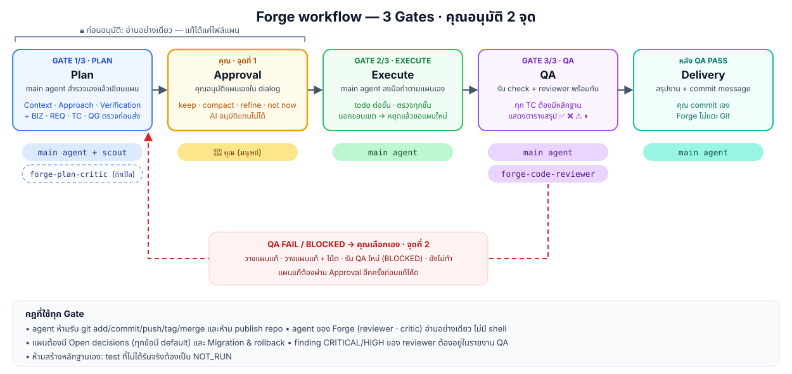
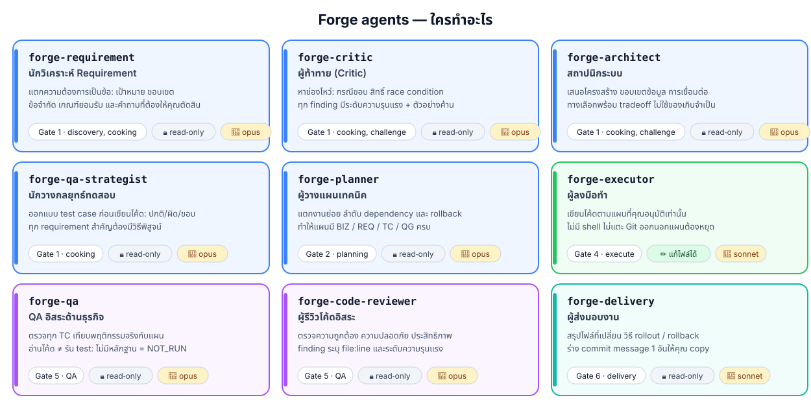

# Forge

**Forge** ทำให้ AI เขียนโค้ดอย่างมีขั้นตอนแบบทีมจริง: วิเคราะห์ requirement → วางแผน → **คุณอนุมัติ** → ลงมือ → QA อิสระ → ส่งมอบ
แต่ละขั้นมี agent เฉพาะทางทำหน้าที่ของตัวเอง และ Forge จะไม่ยอมให้ข้ามขั้น

ใช้ได้กับ **Claude Code** (plugin) และ **Oh My Pi / OMP** (extension) โดยใช้ core เดียวกัน



## ทำไมต้อง Forge

- **ไม่มีโค้ดก่อนคุณอนุมัติ** — ก่อน Gate 3 ทุกอย่างอ่านอย่างเดียว AI อนุมัติแผนแทนคุณไม่ได้
- **ตรวจได้ทุกข้อ** — แผนต้องมี Business Topic (BIZ), Requirement (REQ), Test Case (TC) และ Quality Gate (QG) ที่ QA ใช้ตรวจย้อนได้ทีละข้อ
- **QA ไม่เชื่อคำพูด** — test ที่ไม่ได้รันจริงต้องเป็น `NOT_RUN` ถ้า QA ไม่ผ่าน ต้องทำแผนแก้และอนุมัติใหม่
- **Git เป็นของคุณ** — agent ห้าม `git add/commit/push` และห้าม publish ทุกขั้น Forge แค่ร่าง commit message ให้ copy

## Agents ทั้ง 9 ตัว



| Agent | Gate | หน้าที่ | สิทธิ์ |
|---|---|---|---|
| `forge-requirement` | 1 | แตกความต้องการเป็นข้อ ๆ: เป้าหมาย ขอบเขต เกณฑ์ยอมรับ คำถามที่ต้องให้คุณตัดสิน | อ่านอย่างเดียว |
| `forge-critic` | 1 | หาช่องโหว่และกรณีที่จะพัง: สิทธิ์ ข้อมูล race condition ความล้มเหลวบางส่วน | อ่านอย่างเดียว |
| `forge-architect` | 1 | เสนอโครงสร้างระบบ ทางเลือก และ tradeoff | อ่านอย่างเดียว |
| `forge-qa-strategist` | 1 | ออกแบบ test case ตั้งแต่ก่อนเขียนโค้ด | อ่านอย่างเดียว |
| `forge-planner` | 2 | แตกงานย่อย ลำดับงาน rollback และโครง BIZ/REQ/TC/QG | อ่านอย่างเดียว |
| `forge-executor` | 4 | เขียนโค้ดตามแผนที่อนุมัติเท่านั้น (ไม่มี shell, ไม่แตะ Git) | **แก้ไฟล์ได้** |
| `forge-qa` | 5 | ตรวจทุก TC เทียบพฤติกรรมจริงกับแผน | อ่านอย่างเดียว |
| `forge-code-reviewer` | 5 | รีวิวความถูกต้อง ความปลอดภัย ประสิทธิภาพ พร้อม file:line | อ่านอย่างเดียว |
| `forge-delivery` | 6 | สรุปงาน วิธี rollout/rollback และร่าง commit message | อ่านอย่างเดียว |

Gate 1 ทำงาน 3 ขั้นย่อย: **discovery** (`forge-requirement`) → **cooking** (4 ตัวพร้อมกัน) → **challenge** (`forge-critic` + `forge-architect` ตรวจซ้ำ)

## คำสั่ง

พิมพ์ `/forge` ใน Claude Code แล้วเลือกจากเมนูได้เลย (ใน OMP ใช้ `/forge <คำสั่งย่อย>` เช่น `/forge status`)

| คำสั่ง | ใช้เมื่อ |
|---|---|
| `/forge <requirement>` | เริ่มงานใหม่ แบบรอบคอบเต็มรูปแบบ (ค่าเริ่มต้น) |
| `/forge-fast <requirement>` | เริ่มงาน โดย main ทำ intake เอง แทน discovery agent (ยังผ่าน challenge ทุกครั้ง) |
| `/forge-quick <requirement>` | งานเล็กมาก ใช้ specialist 2 ตัว — **ความรอบคอบต่ำ** |
| `/forge-thorough <requirement>` | บังคับโหมดรอบคอบ แม้ตั้งค่าเริ่มต้นเป็นอย่างอื่น |
| `/forge-status` | ดูว่าอยู่ Gate ไหน และกำลังรอ agent ตัวไหน |
| `/forge-plan` | ดู path ของแผนที่ส่งอนุมัติ |
| `/forge-approve` | อนุมัติแผนเอง เมื่อ Forge มองไม่เห็นการอนุมัติ (เช่น context ถูกล้าง) |
| `/forge-qa` | เริ่มหรือรัน QA ใหม่ |
| `/forge-rework` | ทำแผนแก้ไขหลัง QA ไม่ผ่าน (ต้องอนุมัติใหม่) |
| `/forge-delivery` | ดู commit message หรือทำขั้นส่งมอบต่อ |
| `/forge-report` | ดู path รายงาน QA ล่าสุด |
| `/forge-resume [เลข]` | ดูงาน Forge ใน session อื่นของโปรเจกต์นี้ หรือดึงมาทำต่อ |
| `/forge-mode [thorough\|fast\|quick]` | ดูหรือตั้งโหมด requirement เริ่มต้น |
| `/forge-agents` | รายชื่อ agent |
| `/forge-trace [on\|off]` | บันทึก event สำหรับทดสอบ flow (ดู [แผนทดสอบ](docs/E2E-TEST-PLAN_TH.md)) |
| `/forge-off` | ยกเลิกงาน (ไม่แก้ไฟล์ ไม่แตะ Git) |

AI เรียกคำสั่งเหล่านี้แทนคุณไม่ได้ ทุกคำสั่งต้องพิมพ์เอง

## โหมด Requirement

| โหมด | Specialist | เหมาะกับ |
|---|---|---|
| `thorough` (ค่าเริ่มต้น) | 7 ครั้ง ครบ 3 ขั้น | งานทั่วไป งานที่มีความเสี่ยง |
| `fast` | 6 ครั้ง (ไม่มี discovery agent) | งานที่ requirement ชัดอยู่แล้ว |
| `quick` | 2 ตัว (challenge เฉพาะเมื่อพบความเสี่ยงสูง) | แก้เล็กน้อย เช่น comment ข้อความ |

## ค่าใช้ token

Forge ใช้หลาย agent จึงกิน token มากกว่าการสั่ง Claude ตรง ๆ เลือกระดับโมเดลตอน build ได้ (ไม่ลดขั้นตอน ลดแค่โมเดล):

| `FORGE_MODELS` | opus | sonnet | haiku |
|---|---|---|---|
| `rigor` (ค่าเริ่มต้น) | 7 ตัว | executor, delivery | — |
| `balanced` | critic, planner, qa, code-reviewer | requirement, architect, qa-strategist, executor | delivery |
| `economy` | — | 8 ตัว | delivery |

```bash
FORGE_MODELS=balanced npm test
```

Forge ไม่ยอมให้ specialist ตัวเดิมรันซ้ำใน Gate เดียวกัน (กำลังรันอยู่ หรือรายงานแล้ว) เพื่อตัดค่าใช้จ่ายที่ไม่ได้เพิ่มความครอบคลุม

## ตัวอย่าง 1 รอบ

```text
/forge เพิ่มฟังก์ชันคำนวณอายุจากวันเกิด พร้อม unit test
```

1. agent ใน Gate 1 วิเคราะห์ (ทำงานเบื้องหลังได้ — รอได้เลย)
2. `forge-planner` วางแผน แล้ว Claude ส่งแผนเข้าหน้าอนุมัติ (Forge ตรวจรูปแบบแผนก่อน)
3. **คุณอ่านแผนแล้วกดอนุมัติ**
4. `forge-executor` เขียนโค้ด แล้ว main รัน test
5. `forge-qa` + `forge-code-reviewer` ตรวจ ถ้าไม่ผ่าน กลับไปทำแผนแก้
6. `forge-delivery` สรุปงาน และให้ commit message — คุณ review diff แล้ว commit เอง

## ตัวอย่างเครื่องคำนวณอายุ

รันโปรแกรมด้วยวันเกิดรูปแบบ `YYYY-MM-DD` เช่น:

```bash
node examples/age-calculator.mjs 2000-02-29
```

โปรแกรมแสดงอายุเต็มเป็นปี โดยใช้วันที่ปัจจุบันตามเขตเวลาท้องถิ่นของเครื่อง วันที่ต้องเป็นวันจริงตามปฏิทินเกรกอเรียนและใช้ปี ค.ศ. 4 หลัก หากเกิดวันที่ 29 กุมภาพันธ์ วันครบรอบในปีที่ไม่ใช่ปีอธิกสุรทินจะเป็นวันที่ 1 มีนาคม

## ติดตั้ง

```bash
npm test                       # build + ทดสอบ (Node 22+)
```

**Claude Code**
```bash
mkdir -p ~/.claude/marketplaces && cp -R dist/claude-code/forge-marketplace ~/.claude/marketplaces/
claude plugin marketplace add ~/.claude/marketplaces/forge-marketplace
claude plugin install forge@forge-local
```

**OMP**
```bash
cd dist/omp/omp-forge-global-v*/ && bash ./install.sh
```

รายงาน แผน และ commit message ถูกเก็บไว้นอกโปรเจกต์ (data dir ของ plugin) Forge ไม่เขียนไฟล์ลง repo ของคุณ

## เอกสารเพิ่มเติม

- [โครงสร้างโค้ดและการ build](docs/DEVELOPMENT.md)
- [สถาปัตยกรรม core + adapter](docs/ARCHITECTURE.md)
- [แผนทดสอบใน Claude Code จริง](docs/E2E-TEST-PLAN_TH.md)
- [Claude Code plugin](PLUGIN.md)
