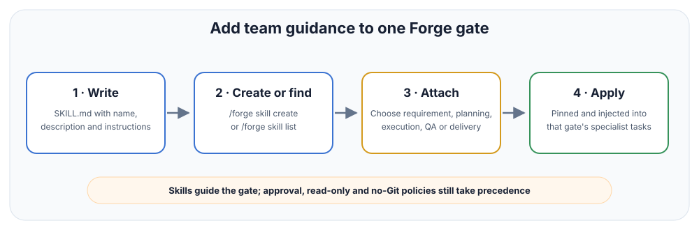

# Custom gate skills (OMP)

Yes. OMP Forge supports custom Markdown skill packs and lets you attach them to a Forge gate. A skill is not a new agent or a permission grant: Forge adds its instructions to specialist task prompts for that gate, while Forge's approval, read-only, and no-Git rules still win.



## Create from OMP

Use the interactive editor in the main OMP TUI:

```text
/forge skill create planning
```

Or run `/forge skill` to open the gate/action picker, then choose **Create skill from Markdown**. To choose the gate inside the picker, run `/forge skill create` without a gate name.

Forge validates the Markdown, writes it without overwriting an existing skill, and attaches it to the selected gate. It creates skills under:

```text
~/.omp/agent/skills/<skill-name>/SKILL.md
```

When `PI_CODING_AGENT_DIR` is set, the path is `$PI_CODING_AGENT_DIR/skills/<skill-name>/SKILL.md` instead.

## Example

The README includes a complete `api-contract-review` skill example and a command to attach an existing skill to `planning`. Use that sample as a starting point, then customize it for your team and repository.

A skill file must have simple YAML frontmatter with a lowercase kebab-case `name`, a one-line `description`, and non-empty Markdown instructions:

```markdown
---
name: my-skill
description: Describe when this instruction should be used.
---

# My Skill

## Instructions
- Give concrete, gate-specific guidance.
```

Limits: skill names are 1–64 lowercase letters, digits, or hyphens and start with a letter; one `SKILL.md` is at most 24 KiB; descriptions are at most 1024 characters. Forge accepts simple single-line frontmatter fields, not nested YAML or folded values. Each gate can have at most six attached skills, and combined skill text for one gate cannot exceed 96 KiB.

## Find and attach an existing skill

`/forge skill list` lists eligible packs discovered in the OMP agent skill directory and `~/.claude/skills`. Then attach a pack:

```text
/forge skill add planning api-contract-review
/forge skills
```

The `/forge skills` command shows the current gate-to-skill mapping. You can also use `/forge skill` and select **Add skill** in the interactive picker.

Remove a binding without deleting the skill file:

```text
/forge skill remove planning api-contract-review
```

Reset a gate's bindings, or restore all bundled defaults:

```text
/forge skill reset planning
/forge skill reset all
```

Resetting one gate clears its bindings; it does not delete or edit any `SKILL.md`. Resetting `all` restores Forge's bundled defaults.

## Gate behavior and safety

- Supported gate names: `requirement`, `planning`, `execution`, `qa`, `delivery`.
- Bundled defaults attach requirement, planning, execution, and QA skills. Delivery has no bundled default, but custom delivery skills can be attached.
- Skills are pinned by path and SHA-256 when a Forge workflow starts. Forge rejects a skill that changes or disappears mid-workflow.
- Global skill settings cannot be changed while a Forge workflow is active. Finish or cancel the workflow, change bindings, then start a new workflow.
- An attached skill is included in each named specialist task for its gate. Skills guide behavior but cannot override approved scope, approval checks, read-only restrictions, or the no-commit policy.
- Claude Code does not currently provide the `/forge skill` management flow. This documentation covers OMP.

For all Forge commands and phase behavior, see the [user guide](USER_GUIDE.md).
